<p align="center">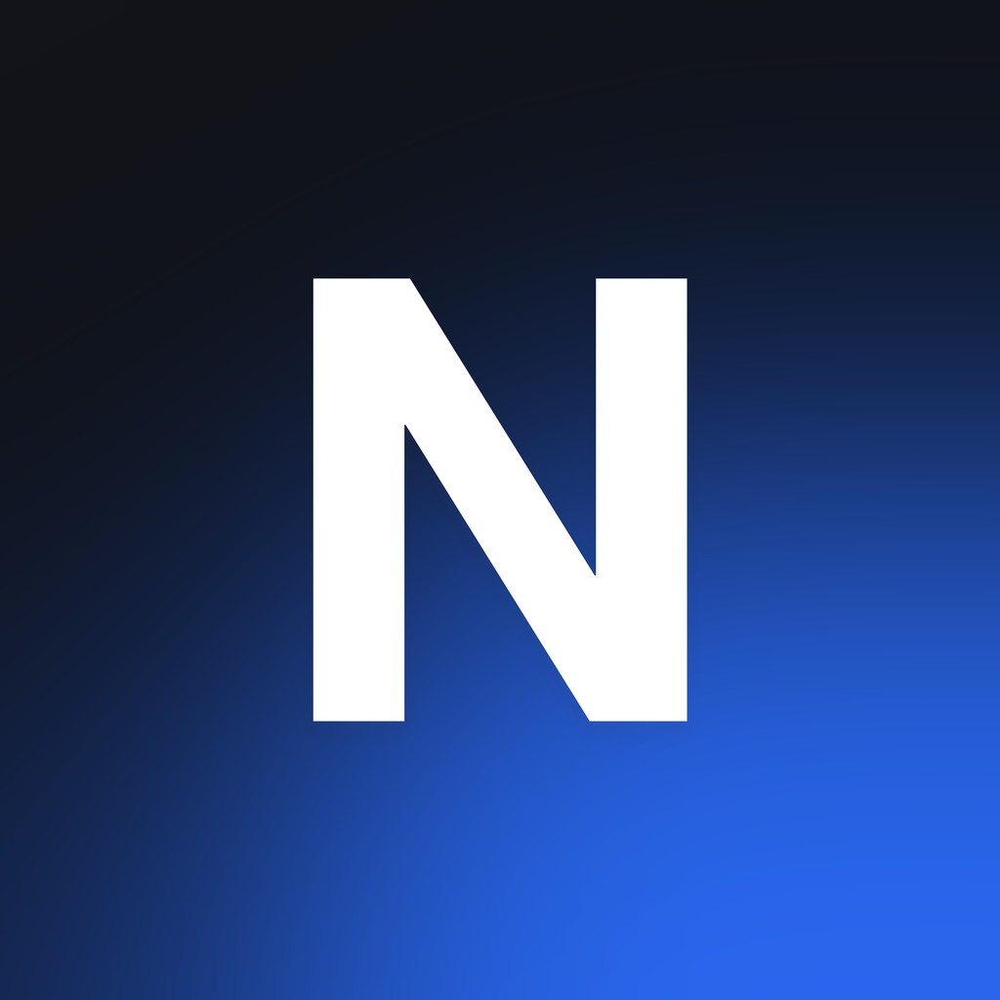</p>

# nexo

une mac, iphone y apple watch en la red local. la mac es el hub (app de barra de menús); el iphone y el reloj la controlan y reciben su estado: volumen, brillo, música, trackpad, teclado, apps, portapapeles, captura, bloqueo y más.

- canal propio por tcp + bonjour, firmado con hmac-sha256 derivado de un código de 12 caracteres. sin servidores ni cuentas.
- el reloj controla la mac por conexión directa por wi-fi o, si no la hay, a través del iphone.
- ui con liquid glass nativo (ios 26+, watchos 26+, macos 26+).

## capturas

### iphone

**inicio** · la pantalla principal, entera, sin scroll.

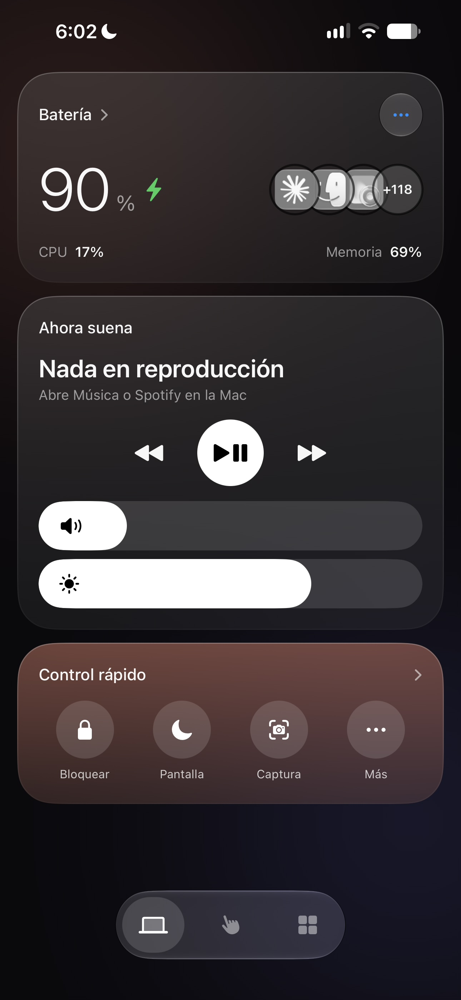

- tarjeta superior: batería de la mac (90 %, con el rayo verde porque está cargando), cpu 17 % y memoria 69 %. a la derecha, las apps abiertas en círculos solapados con "+118" del resto; arriba a la derecha, el menú de tres puntos (reintentar conexión, desemparejar). tocar "batería >" abre el detalle.
- tarjeta "ahora suena": título de la canción (aquí no hay nada reproduciéndose), anterior, play/pausa en círculo blanco y siguiente. debajo, dos deslizadores de cápsula: volumen (arriba) y brillo (abajo).
- tarjeta cálida "control rápido": bloquear, apagar pantalla, captura y "más".
- abajo, la barra flotante de tres iconos: mac (activa), trackpad y apps.

**trackpad** · superficie táctil a pantalla completa.

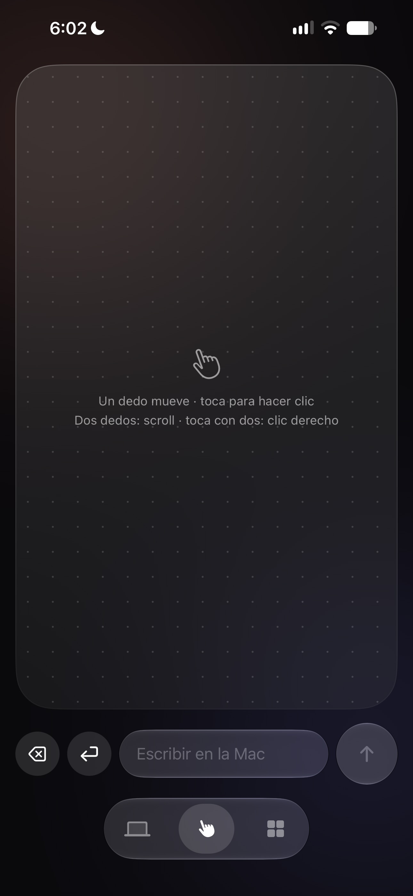

- un dedo mueve el cursor, un toque es clic, dos dedos hacen scroll y un toque con dos dedos es clic derecho (el texto de ayuda lo dice en pantalla).
- la rejilla de puntos da textura a la superficie.
- fila inferior: borrar, enter, campo "escribir en la mac" y botón de enviar. lo que se escribe se pega donde esté el cursor de la mac.

**apps** · lista de las apps de la mac con sus iconos reales.

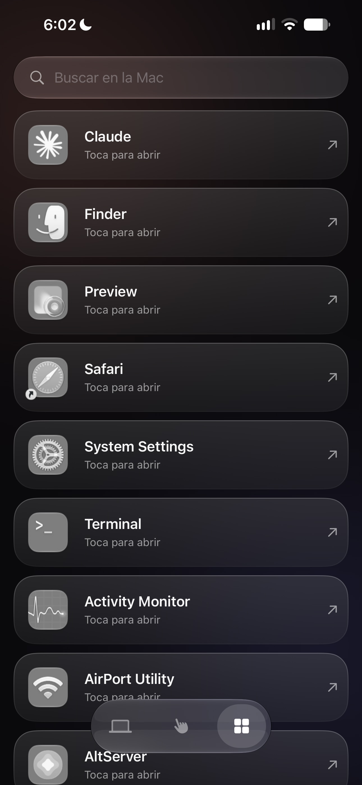

- cápsula de búsqueda arriba. cada fila muestra el icono de la app (claude, finder, preview, safari, ajustes del sistema, terminal, monitor de actividad, airport utility, altserver) y una flecha; tocar abre la app en la mac.
- las apps abiertas salen primero y el resto va en orden alfabético.

**detalle de batería y estado** · se abre al tocar "batería >".

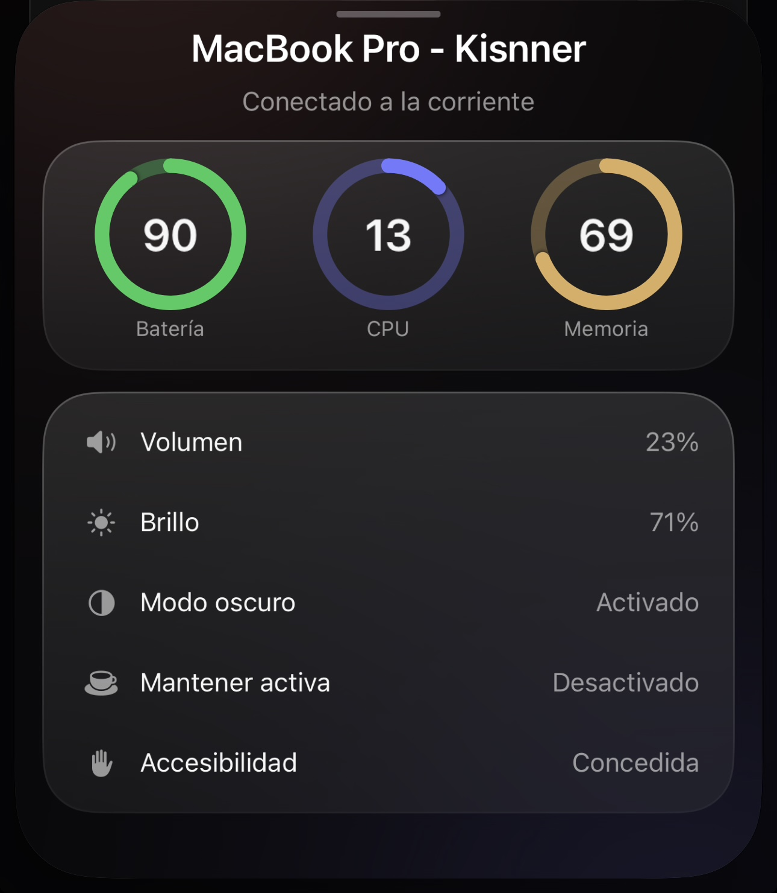

- encabezado con el nombre de la mac y "conectado a la corriente".
- tres anillos: batería 90, cpu 13 y memoria 69.
- lista de estado: volumen 23 %, brillo 71 %, modo oscuro activado, mantener activa desactivado y accesibilidad concedida (el permiso que necesita la mac para mover el cursor y teclear).

**más acciones** · hoja que se abre desde "control rápido".

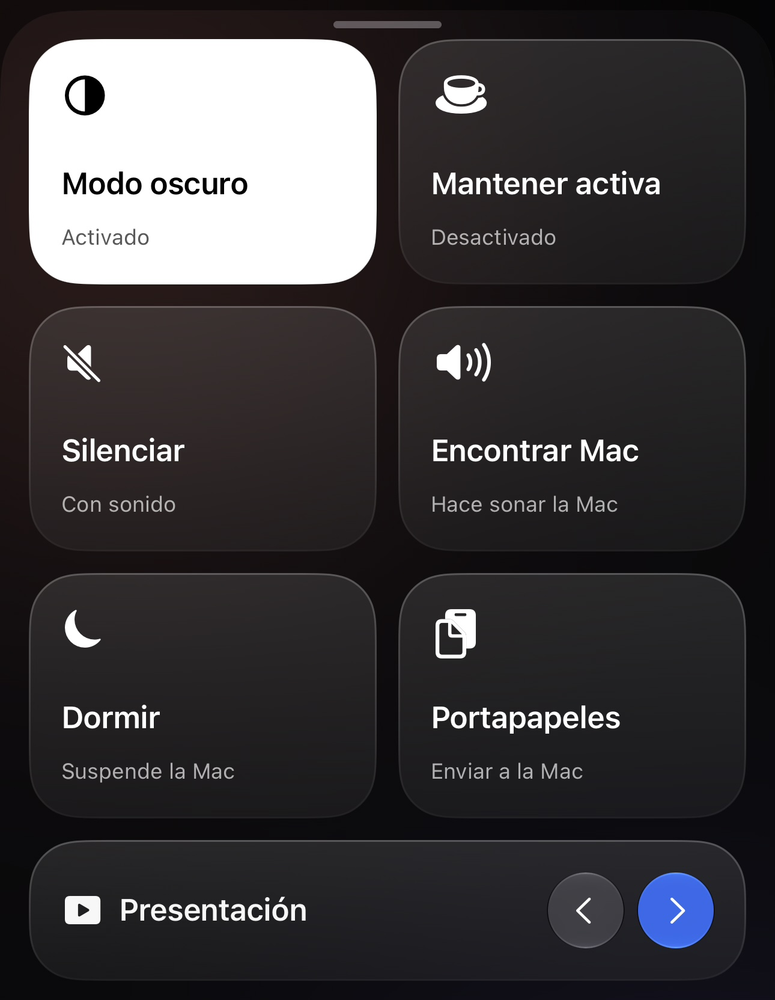

- mosaicos grandes: modo oscuro (en blanco porque está activo), mantener activa, silenciar, encontrar mac (la hace sonar), dormir y portapapeles.
- fila inferior "presentación" con flechas anterior/siguiente para pasar diapositivas.

### apple watch

<table>
<tr>
<td align="center">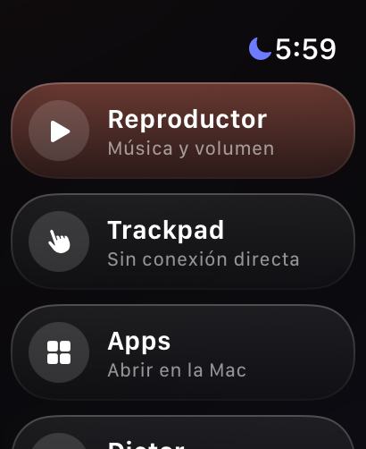<br><b>inicio</b></td>
<td align="center">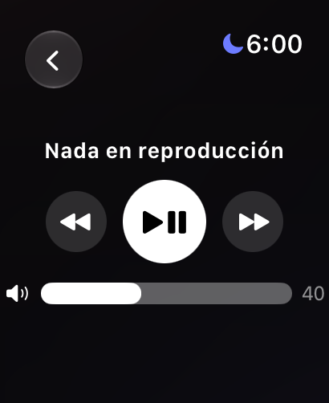<br><b>reproductor</b></td>
<td align="center">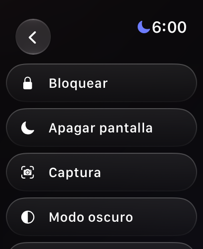<br><b>sistema</b></td>
</tr>
<tr>
<td align="center">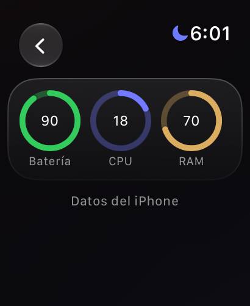<br><b>estado</b></td>
<td align="center">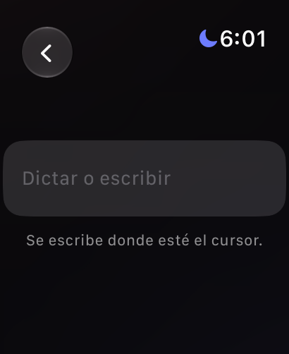<br><b>dictar</b></td>
<td></td>
</tr>
</table>

- **inicio**: lista de tarjetas oscuras con botón redondo. "reproductor" (en salmón) abre la música y el volumen; "trackpad" muestra el estado de conexión en su subtítulo; "apps" abre apps de la mac. más abajo están dictar, sistema y batería.
- **reproductor**: título de la canción (aquí "nada en reproducción"), anterior, play/pausa en círculo blanco, siguiente y barra de volumen (40). la corona digital cambia el volumen.
- **sistema**: acciones en filas de cápsula: bloquear, apagar pantalla, captura, modo oscuro y el resto de la lista.
- **estado**: batería 90, cpu 18 y ram 70 en anillos; el texto de abajo ("datos del iphone") indica que las cifras llegaron por el iphone y no por conexión directa.
- **dictar**: campo para dictar o escribir; el texto se escribe donde esté el cursor en la mac.

### mac

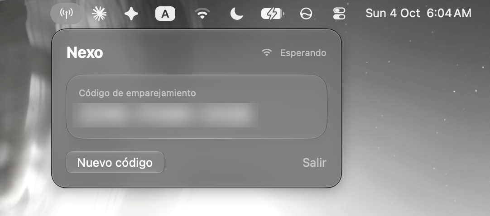

menú de la app de barra de menús (icono de antena arriba a la izquierda). título "nexo", estado de red ("esperando" porque no hay ningún dispositivo conectado), tarjeta con el código de emparejamiento (difuminado aquí) y los botones "nuevo código" y "salir". cuando falta el permiso de accesibilidad aparece también un botón para pedirlo.

## instalar

requisitos: xcode, `xcodegen` (`brew install xcodegen`), una cuenta de apple (la gratuita sirve; el perfil caduca a los 7 días y hay que repetir el comando).

```bash
./scripts/install-mac.sh                          # hub en /Applications
TEAM_ID=XXXXXXXXXX ./scripts/install-devices.sh   # iphone (el reloj se instala desde ahí)
```

abre nexo en la mac, copia el código del menú y escríbelo en el iphone. el reloj lo recibe solo. en la mac, activa nexo en ajustes del sistema > privacidad y seguridad > accesibilidad (trackpad, teclado y diapositivas lo necesitan).

## estructura

```
Packages/NexoCore   protocolo, canal con hmac, cliente con reconexión, caché de iconos
Mac/                hub: listener bonjour, acciones, osd de volumen y brillo
Phone/              app del iphone
PhoneWidgets/       controles del centro de control y widget de estado
Watch/              app del reloj
scripts/            instalación e iconos
docs/               capturas y arquitectura
```

más detalle en [docs/arquitectura.md](docs/arquitectura.md).

## estado

proyecto personal en desarrollo. el protocolo y el hub están probados con una sonda de línea de comandos (`nexoprobe`) y tests del canal; la comunicación reloj–mac a través del iphone se está afinando.

licencia mit.
